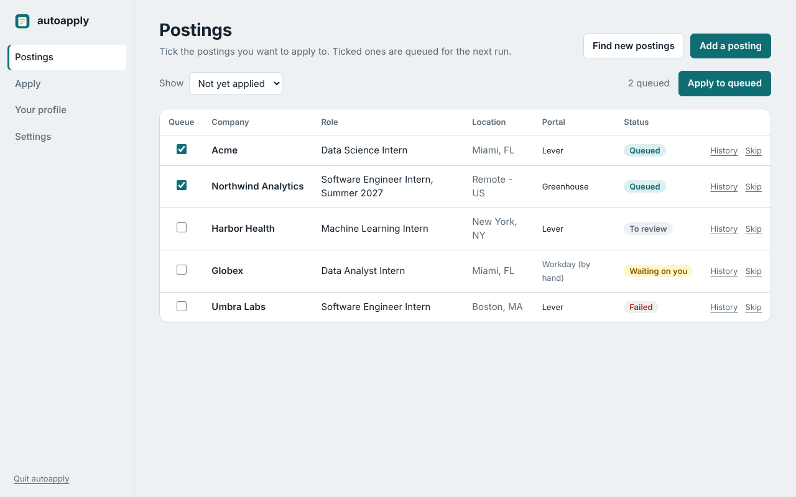
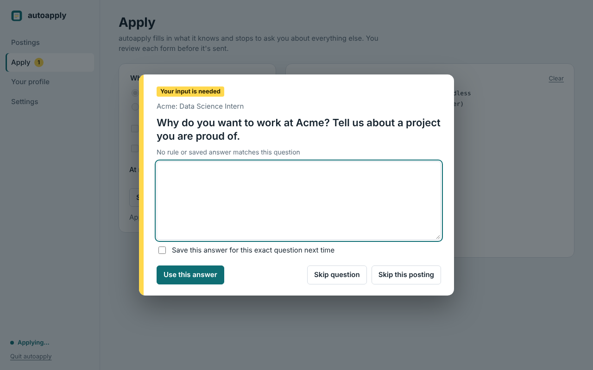

# autoapply

A human-in-the-loop job application assistant for internships and entry-level software/data roles.
It finds postings on public ATS job boards, lets you pick which ones to apply to, fills the forms
from one normalized profile, and **stops and asks you** whenever an answer isn't something you've
already told it — essays, unfamiliar dropdowns, salary, consents, CAPTCHAs.

Runs on **Windows 11** and **Arch Linux** (Wayland/Hyprland or X11) as a desktop app, with a full
command line alongside it.



When it needs you, the app chimes, sends a desktop notification and asks in a dialog:



```
profile_data.yaml ─┐
resume.pdf/.json ──┼─► profile build ─► user_profile.json ─┐
LinkedIn export ───┤                                       │
GitHub ────────────┘                                       ▼
Greenhouse/Lever ──► jobs fetch ─► SQLite ─► jobs select ─► run ─► Playwright + ATS adapter
  board APIs           (filters)   tracker    (Textual TUI)          │
                                                                    ├─ known field → fill
                                                                    ├─ unknown / essay / CAPTCHA → ping you, wait
                                                                    └─ review → submit → verify → log
```

## Install

Download the bundle for your OS from [Releases](../../releases/latest) and run its installer.
Python isn't required; the installer brings [uv](https://docs.astral.sh/uv/), which brings Python.

```bash
# Linux (Arch or any distro)
tar xzf autoapply-*-linux.tar.gz && cd autoapply-*-linux && ./install.sh
```
```powershell
# Windows 11
powershell -ExecutionPolicy Bypass -File .\install.ps1
```

This installs the app, downloads Chromium, creates your workspace in `~/autoapply`
(`%USERPROFILE%\autoapply`) and adds **autoapply** to your app launcher / Start menu.
Set `AUTOAPPLY_HOME` to put the workspace elsewhere.

## Using the app

1. **Your profile**: choose your resume PDF and fill in your details (name, school, work
   authorization, saved answers). Save, then *Rebuild profile*.
2. **Settings**: add the Greenhouse boards and Lever companies to search, and your title and
   location filters.
3. **Postings**: *Find new postings*, or *Add a posting* by URL. Tick the ones to apply to.
4. **Apply**: start with *Practice run* ticked to watch it fill a form without submitting.
   Leave *Show the browser* on to watch and to solve CAPTCHAs.

The app is a local web UI in a chromeless Edge/Chrome/Chromium window. It only listens on
127.0.0.1 and every request needs a random per-launch token. `autoapply gui --no-window`
prints its address if you'd rather use a normal browser tab.

## Command line (from source)

```bash
# Arch
./scripts/setup_arch.sh
# Windows 11 (PowerShell, from repo root)
powershell -ExecutionPolicy Bypass -File .\scripts\setup_windows.ps1
```

Then:

```bash
# 1. fill in config/profile_data.yaml and config/config.yaml; drop your resume at data/private/resume.pdf
uv run autoapply profile build          # → data/user_profile.json
uv run autoapply jobs fetch             # pull + filter postings from configured boards
uv run autoapply jobs add <url> --company Acme --role "Data Science Intern"   # or add one by hand
uv run autoapply jobs select            # check/uncheck in the TUI (space, a, n, c to confirm)
uv run autoapply run --dry-run -n 1     # fill one form, never submit — do this first
uv run autoapply run                    # headed by default; --headless to run in the background
uv run autoapply resume                 # finish jobs parked as pending_input (always headed)
uv run autoapply jobs list -s applied   # tracker
uv run autoapply log <job_id>           # per-application event log
uv run autoapply doctor                 # environment check
uv run autoapply gui                    # the desktop app
```

## How the pauses work

| Situation | What happens |
|---|---|
| Field matches a rule in `field_mapper.py` or a saved answer | Filled automatically |
| Required field with no matching data (essays, custom questions) | Sound + desktop notification, browser raised, terminal prompt. Answer, pick an option number, `:b` to fill it in the browser yourself, `:s` skip field, `:x` skip job |
| Profile value doesn't match any dropdown option *uniquely* | Treated as unknown → prompt (never "closest guess") |
| Salary | Always asked unless you set `preferences.salary_expectation` |
| Required checkbox (consent, attestation) | Always asked |
| CAPTCHA / Cloudflare / hCaptcha | Headed: you solve it, press Enter. Headless: job → `pending_input`, run continues |
| Before submit | Summary table of everything filled; you choose submit / click it yourself / abort |
| Portal with no adapter (Workday, Ashby, Taleo…) | Page opens for you to apply by hand; you record the outcome |

Answers you type can be saved (`data/answers_learned.yaml`) and are reused for identical questions.

## Design choices worth knowing

- **No stealth / fingerprint spoofing.** The browser is a normal persistent Chromium profile at
  human pace, and every bot check goes to you. Evasion plugins are the part of these tools most
  likely to get accounts flagged, and they'd conflict with the "never bypass a CAPTCHA" rule.
- **Never guess.** Mapping rules only ever return data you supplied; ambiguity → pause.
- **Review before submit** is on by default (`automation.require_submit_confirmation`).
- **Public APIs only** for discovery (Greenhouse and Lever job-board APIs). LinkedIn data comes
  from your official data export; nothing scrapes LinkedIn.
- Respect each site's terms and rate limits (`rate_limits` in config). Applying selectively
  beats volume anyway.

## Repository layout

```
autoapply/
├── .github/workflows/
│   ├── ci.yml                    # lint + tests on Ubuntu and Windows, gitleaks scan
│   └── release.yml               # tag v* → build, install-test on both OSes, publish Release
├── .gitignore                    # security-first: resumes, DBs, sessions, real configs
├── .gitattributes                # LF for .sh/.py, CRLF for .ps1
├── .pre-commit-config.yaml       # gitleaks + "no resumes/DBs/configs" guard
├── .env.example
├── pyproject.toml                # uv project, entry point `autoapply`
├── config/                       # created by `autoapply init` (git-ignored)
├── data/                         # git-ignored runtime data (see data/README.md)
├── docs/
│   ├── ARCHITECTURE.md
│   ├── SETUP.md                  # Arch + Windows step by step
│   └── ADAPTERS.md               # writing a new ATS adapter
├── scripts/                      # dev setup from a source checkout
│   ├── setup_arch.sh
│   └── setup_windows.ps1
├── packaging/                    # installers shipped inside the release bundles
│   ├── install.sh
│   └── install.ps1
├── src/autoapply/
│   ├── cli.py                    # Typer commands
│   ├── config.py                 # pydantic config + cross-platform path resolution
│   ├── notify.py                 # desktop notification + sound (Linux/Windows)
│   ├── profile/                  # models, parser (YAML/JSON Resume/LinkedIn/PDF/GitHub), saved answers
│   ├── store/db.py               # SQLite tracker + application log
│   ├── jobs/                     # Greenhouse/Lever sources, filters
│   ├── gui/                      # desktop app: local API, event stream, dialogs, app window
│   │   └── static/               # the UI (HTML/CSS/JS, no build step)
│   ├── tui/queue.py              # Textual selection queue
│   ├── templates/                # config.example.yaml, profile_data.example.yaml
│   └── automation/
│       ├── browser.py            # persistent Chromium, Wayland flags
│       ├── fields.py             # generic form introspection (labels, options, required)
│       ├── field_mapper.py       # profile → field rules, strict option matching
│       ├── challenges.py         # CAPTCHA/Cloudflare detection
│       ├── hitl.py               # all human pauses
│       ├── runner.py             # queue loop, rate limits, failure screenshots
│       └── adapters/             # base template, greenhouse, lever, manual fallback
└── tests/                        # unit tests, offline Lever form in real Chromium, GUI end-to-end
```

## Status

Greenhouse and Lever adapters are the reference implementations. ATS markup changes over time,
so do a `--dry-run` on a live posting after setup and after upgrades. See `docs/ADAPTERS.md` to add
Ashby, Workday and others.

MIT licensed.
