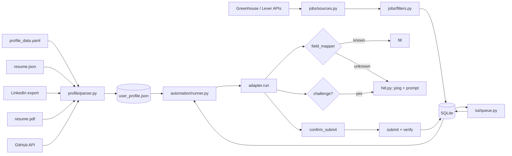

# Architecture

## Tech stack

| Concern | Choice | Why |
|---|---|---|
| Language / packaging | Python 3.11+, `uv` | One lockfile, fast installs, manages Python itself on Windows |
| Browser automation | Playwright (async, Chromium) | Best auto-waiting, file uploads, persistent profiles; same API on both OSes |
| Config & schemas | YAML + pydantic v2 | Human-editable files, validated typed objects |
| Tracker | SQLite (stdlib) | Zero setup, queryable, WAL mode for safety |
| CLI | Typer + Rich | Discoverable commands, readable prompts and tables |
| Selection UI | Textual | Real checklist UI in any terminal (Windows Terminal, kitty, foot, Alacritty) |
| Notifications | `desktop-notifier` → `notify-send` fallback; `winsound` / `pw-play` | DBus on Linux, WinRT toasts on Windows |
| Discovery | Greenhouse + Lever public job-board APIs via `httpx` | Official, unauthenticated, no scraping |

## Data flow



## Job state machine

```
discovered ──select──► queued ──run──► in_progress ──► applied
     ▲                   │                 │ ├──────► failed        (exception; screenshot saved)
     └──── deselect ─────┘                 │ ├──────► skipped       (you chose :x / abort)
                                           │ └──────► pending_input (headless challenge, timeout,
                                           │                         no adapter while headless)
                         queued ◄── dry run┘
pending_input ──resume (headed)──► in_progress ──► …
```

Every transition is also written to `application_log` with a timestamp.

## The adapter template (`adapters/base.py`)

1. `open()` — navigate (Greenhouse also unwraps embedded `#grnhse_iframe`; Lever appends `/apply`)
2. `handle_challenges()` — visible reCAPTCHA/hCaptcha/Turnstile iframe or Cloudflare interstitial → human
3. `prepare_form()` — click "Apply" if needed, wait for the form
4. `fill_form()` — up to 5 passes: collect fields → **upload files first** (ATSs parse the resume and
   prefill/reveal fields) → re-scan → map each remaining field
5. Required-field sweep — anything still empty and required goes to the human
6. Dry run stops here
7. `confirm_submit()` — table of filled values; submit / you click / abort
8. `submit()` → challenge check again → `verify_submitted()` (URL/text) → else ask you

### Field resolution order (`field_mapper.py`)

1. Saved answers (`answers` in profile_data.yaml + `answers_learned.yaml`), regex on the label
2. Long textarea prompts (> 40 chars) → always human (essays)
3. Built-in rules, first match wins (name, contact, links, location, education, GPA, graduation,
   work authorization, sponsorship, start date, relocation, salary, EEOC)
4. No match → human if required (or if `ask_on_optional_unknown`)

For selects, radios and comboboxes, `choose_option` must find **exactly one** option
(exact → special tokens `decline`/`Yes`/`No` → prefix → substring). Two plausible options = ask.

Rules are deliberately conservative: work-authorization rules return nothing when the question
names a non-US country; "start date" rules ignore month/year sub-fields of education sections.

## Security model

- Real data only in git-ignored paths (`config/*.yaml` except examples, `data/`).
- `.gitignore` additionally blocks `*.pdf`, `*.docx`, DBs, cookies/storage state, `.env`, logs and
  screenshots anywhere in the tree; pre-commit runs gitleaks and a hard block on those file types;
  CI runs gitleaks over history.
- The persistent browser profile holds your ATS sessions: treat `data/browser-profile/` like a password.
- No credentials are ever stored by autoapply. Sign in to ATS accounts yourself in headed mode; the
  persistent profile remembers it.

## Desktop app (`gui/`)

```
autoapply-gui ─► uvicorn on 127.0.0.1:<random port> ─► Starlette API (+ static UI)
      │                    ▲            │ Server-Sent Events (log lines, prompts, job status)
      └─► Edge/Chrome/Chromium --app window (own profile; closing it quits the app)
```

- The GUI reuses the same `Runner` and adapters as the CLI. Only the human-in-the-loop layer
  differs: `GuiHumanInTheLoop` turns each pause into a prompt event and awaits an asyncio future
  that the dialog's answer resolves.
- Stopping a run cancels its task; the posting in progress returns to `queued`.
- Security: loopback-only bind, a random per-launch token on every API call, Host-header check
  against DNS rebinding, and all page content rendered with `textContent` (posting titles come
  from external job boards).
